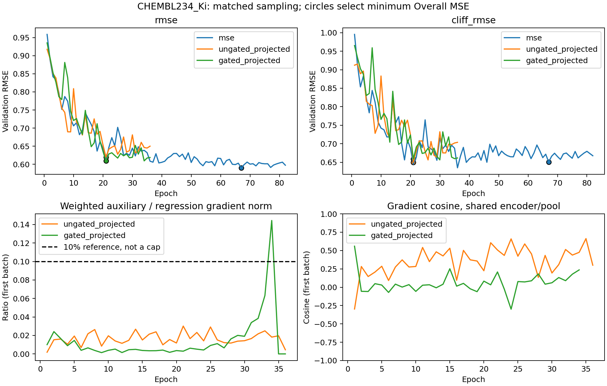

# CHEMBL234：结构门控与投影的固定先导

计划四组，完成并核验 3 组；未完成：gated_raw。两个CUDA故障导致原h门控组停止，不将部分历史纳入完成模型排名。

阶段判断：完整组合相对匹配 MSE 的 Overall/Cliff RMSE 均恶化，暂不扩大该配方。门控改善了无门控投影组的 Overall，但 Cliff 更差，不能把门控称为已验证的修复。原h消融缺失，投影贡献暂不作完整因果归因。

仅官方 train 内验证，seed/split42。四组均使用相同训练内三元组采样；不能与旧均匀采样结果作严格机制归因。

| 组别 | Overall RMSE | Cliff RMSE | best / epochs |
|---|---:|---:|---:|
| MSE（匹配采样） | 0.590215 | 0.650638 | 67 / 82 |
| 投影+归一化，无结构门控 | 0.619922 | 0.649969 | 21 / 36 |
| 严格门控+投影+归一化 | 0.609107 | 0.659068 | 21 / 36 |

相对变化=(完整组合/对照−1)×100%，负值改善。

| 对照 | Overall 变化 | Cliff 变化 |
|---|---:|---:|
| MSE（匹配采样） | +3.20% | +1.30% |
| 投影+归一化，无结构门控 | -1.74% | +1.40% |
| 严格门控，原 h | 未完成，不比较 | 未完成，不比较 |

## 梯度与候选诊断

| 组别 | 加权梯度比中位数 | 最大值 | cosine<0 的抽样比例 | 空批次数 |
|---|---:|---:|---:|---:|
| 投影+归一化，无结构门控 | 1.54% | 3.01% | 2.8% | 0 |
| 严格门控+投影+归一化 | 0.52% | 14.44% | 26.5% | 0 |

测量对象为共享 AtomEncoder、GraphCliffEncoder、SAGPooling 参数，每epoch仅首batch、裁剪前测量；排除两个头。它不是全程梯度上界、不是全部batch平均，也不能单凭cosine证明验证退步原因。

## 实施与预检证据

- 原 GraphCliff 结构未修改。投影头512→128→64（ReLU）后L2归一化，三元组保留L1距离与原标签margin；训练 MSE+.01*triplet，推理不计算投影。骨干四组初始化SHA一致。
- 新掩码仅强制负例 Morgan radius2/2048 bit、无手性 Tanimoto>=.8，且Δy>=1；正例Δy<.2，仍可能跨骨架。复用原ACA标签/hinge/候选平均，替换结构掩码，未改 vendor。
- 初始随机batch预检：440个float32合格有向负例对，但首epoch仅5个三元组、82/83批空；不能只开门控而忽略候选密度。最初float64检查442对，与训练标签精度不同。
- 四组同样每批29普通训练样本+1完整训练内三元组；普通样本每epoch一次，三元组成员额外重复，共91批/2905次样本。新预检首epoch588候选、0空批。MSE对照也使用相同过采样，控制采样混杂。
- MSE、投影无门控、原h有门控、完整组合四组；alpha=.01固定，100epochs/patience15，其他模型和优化超参沿用原先导。最低验证Overall MSE选模，不按Cliff选epoch。
- 六点预检：数值公式、门控与空候选、归一化、CPU/CUDA RNG保护、有限梯度、checkpoint可由原模型strict加载且单分子预测相同。三个完成拟合的最佳checkpoint另进程重载；CSV通过math.fsum重算RMSE。

- gated_raw 首次完成49个epoch后第50轮loss.backward发生CUDA/cuBLAS内部错误；新进程CUDA烟测通过后按同源码/参数/种子从头重试一次，再因illegal instruction中断。CUDA错误可能异步上报，当前调用栈不能精确定位源算子；不能据此断言梯度爆炸或某个模块必然失败。按预定一次恢复预算停止；两次部分历史和故障日志单独保留，不作为完整结果或择优依据。实际三个完成拟合、两次中断尝试，共五次启动。

## 证据边界与下一步

此前“损失大所以梯度主导”“投影头让h纯净”“关闭门控必然导致失败”都不能从原报告直接推出。Hinge只作用于未满足的排序约束，投影头仍把梯度传回骨干。完成的三组仅能检查有投影条件下的门控效应和完整组合相对匹配MSE的效果；由于原h组未完成，不能完整分辨投影+归一化相对原h的贡献。正例、学习率、margin与更多种子尚未消融。

投影 z=normalize(p(hθ)) 时，辅助梯度为 J(hθ)ᵀ J(normalize∘p)ᵀ ∇z Ltriplet，通常不为零；投影改变辅助梯度的路径与方向，不能保证骨干隔离。Loss 的常数偏移可让数值很大而梯度不变，因此需记录 ||.01∇θLtriplet||/||∇θLMSE||，不能用loss比替代。

MAE 对预测的导数为 sign(ŷ−y)/B，MSE 为 2(ŷ−y)/B；MSE更强调大残差，但这不是专门对cliff样本加权。旧MAE对照Cliff RMSE是升高而非降低；该单种子现象不能证明MAE普遍不适合。

单任务单种子且验证集用于选模，不能给出官方测试集结论或统计显著性。直接迁移与这些通用修正不声明原创。新采样改变了训练分布，旧均匀采样MSE只能作参考；不能把与旧配方的差值归因于某一个修改。

