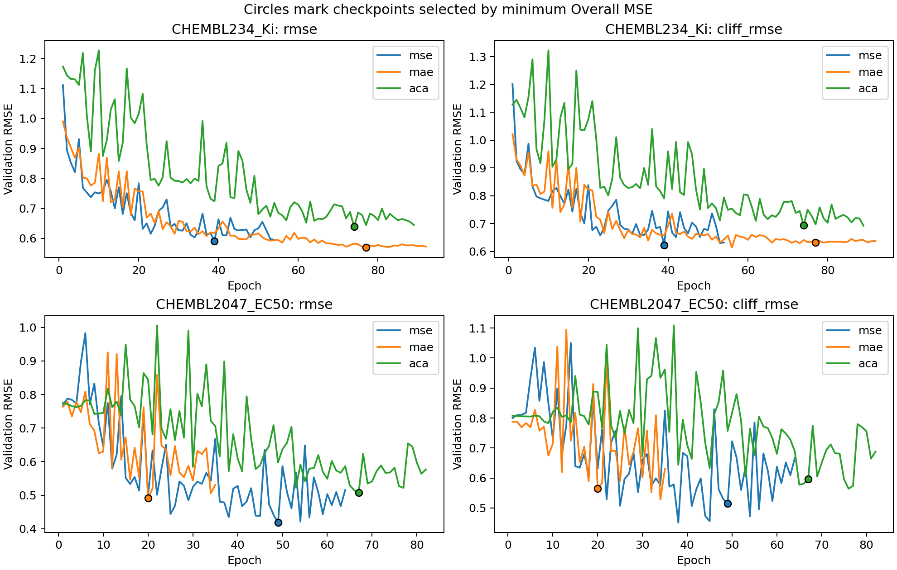
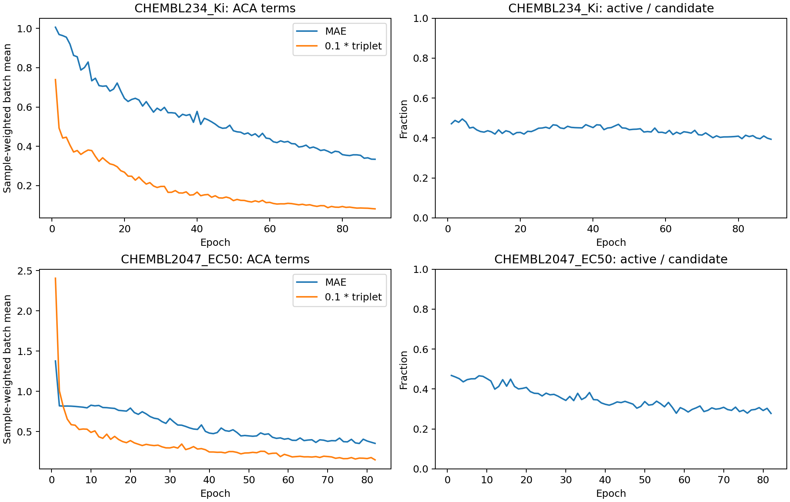

# GraphCliff + ACA 固定先导结果（2026-10-10）

六次训练和独立 checkpoint 重载均完成。以下都是官方 train 内验证结果，不是官方 test 分数。

ACA 相对匹配 MAE 的 Cliff 改善 0/2 个任务，Overall 改善 0/2 个任务。本轮固定直接迁移配方不支持扩大训练；保留为对照基线，不作为论文主方法。不能外推所有对比学习或 ACANet 原架构无效。

| 任务 | 目标 | Overall RMSE | Cliff RMSE | 最佳 epoch / 完成 epoch |
|---|---|---:|---:|---:|
| CHEMBL234_Ki | mse | 0.590632 | 0.622703 | 39 / 54 |
| CHEMBL234_Ki | mae | 0.569119 | 0.632913 | 77 / 92 |
| CHEMBL234_Ki | aca | 0.638240 | 0.694268 | 74 / 89 |
| CHEMBL2047_EC50 | mse | 0.418177 | 0.515139 | 49 / 64 |
| CHEMBL2047_EC50 | mae | 0.490620 | 0.565489 | 20 / 35 |
| CHEMBL2047_EC50 | aca | 0.507210 | 0.597020 | 67 / 82 |

相对变化为 (ACA / 对照 - 1) × 100%，负值表示改善。

| 任务 | 对照 | Overall 变化 | Cliff 变化 |
|---|---|---:|---:|
| CHEMBL234_Ki | mse | +8.06% | +11.49% |
| CHEMBL234_Ki | mae | +12.15% | +9.69% |
| CHEMBL2047_EC50 | mse | +21.29% | +15.90% |
| CHEMBL2047_EC50 | mae | +3.38% | +5.58% |

## 训练诊断

| 任务 | MAE（首轮→末轮） | 加权三元组项（首轮→末轮） | 首轮→末轮激活率 |
|---|---:|---:|---:|
| CHEMBL234_Ki | 1.0062 → 0.3341 | 0.7397 → 0.0818 | 47.1% → 39.4% |
| CHEMBL2047_EC50 | 1.3768 → 0.3531 | 2.4048 → 0.1484 | 46.8% → 27.8% |

Loss 按 batch 样本数加权；候选/激活计数是训练中重复出现的三元组次数，不是唯一化学关系数。所有 ACA epoch 都有候选三元组，loss 重构成立，训练无非有限值触发；这证明对比项实际参与训练，不能推出泛化收益。

## 协议与边界

- 相同初始化 SHA、seed=42、同任务划分、相同原始 GraphCliff 主干；MSE、MAE、MAE+ACA 各两任务，共六次拟合。
- 训练/验证：CHEMBL234 2632/292（验证 cliff=128），CHEMBL2047 452/51（cliff=20）。训练标签 y=-log10(nM)，canonical SMILES 无跨训练/验证重复。
- 原主干 H256/3层/4组/K3/dropout0；batch32、AdamW lr1e-4、wd1e-5、betas(.9,.95)、clip1、warmup10、最多100epochs、patience15。验证 Overall MSE 严格最小选模，不按 Cliff RMSE 选 epoch。内部 LongPoly dropout=0.1 保留。
- 固定 ACA alpha=.1、lower=.2、upper=1、p=1、squared=False、similarity_gate=False，来自官方 README 示例；未做 alphaCV 或超参搜索，不是论文调优复现。实现源、数据与配置 SHA 见 provenance。
- 前两个 MSE 训练完成后重载入口漏取 model_state_dict 外层，修复后从已保存的最佳权重恢复；未增加拟合次数或改变训练/loss。原 provenance 保留，recovery 另存。两次 MSE 训练耗时无法准确恢复，记 null。
- 六个最佳权重均另起进程 strict 加载并复核验证预测、标签、行 ID 和指标，最大预测误差见 audit.json；30 个提供的 checkpoint SHA 全部未变。
- 另用标准库 math.fsum 从 CSV 逐项重算 Overall/Cliff RMSE，与 audit 一致。sklearn 未安装，未为这项检查增加依赖。
- 单种子、两个任务、验证集同时用于选模与效果筛查；小任务仅20个验证 cliff，不能给出统计显著性或测试集结论。原始 cliff_mol 标记沿用数据提供值。
- 关闭结构门控：ACA 约束全局活性表示，合格三元组不保证结构相似，不能称为所有“悬崖三元组”。ACA 移植本身不声明原创。

参数示例：[ACANet README](https://github.com/shenwanxiang/ACANet/blob/6274fa4307ce365a814ac5e93460f0afabaea200/README.md)；固定实现：[loss.py](https://github.com/shenwanxiang/ACANet/blob/4c43e6024345d0ec4d40fdc88ad57224c898b6da/clsar/model/loss.py)。

